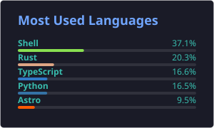

# Mik-TF GitHub Page

## Work

I work with [ThreeFold Tech](https://github.com/threefoldtech) and [ThreeFold Foundation](https://github.com/threefoldfoundation) to create a globally-distributed grid of storage, compute, and network capacity ([see ThreeFold profile](https://www.threefold.io/people/mik-perreault/)).

## Interests

Outside of coding, I am highly interested in mathematics, philosophy and music. 

I am working with my great friend and mathematician Jason Glowney on the book series _Arithmoí - A Study of Mathematical Cohesiveness in Physics and Metaphysics_ (see [Arithmoí profile](https://arithmoi.org/arithmoi-team)). 

The first book [_Mathematical Foundations and the Singularity_](https://arithmoi.org/mathematical-foundations-and-the-singularity) is now available in different formats.
We are currently working on the second book called [_Phenomenology and the Geometry of Light_](https://arithmoi.org/phenomenology-and-the-geometry-of-light
).

## GitHub Statistics

